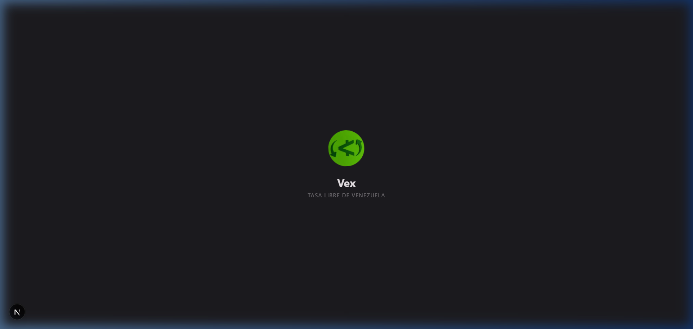
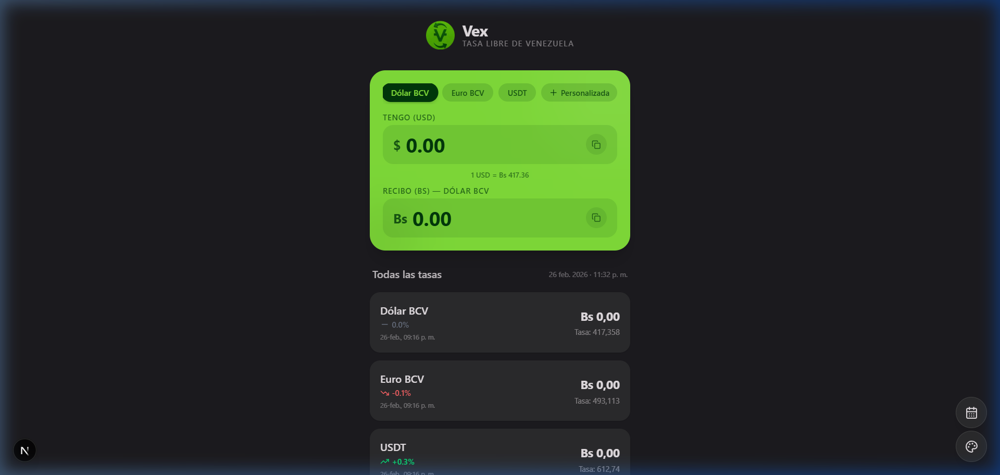
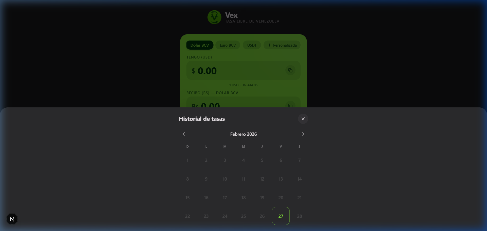
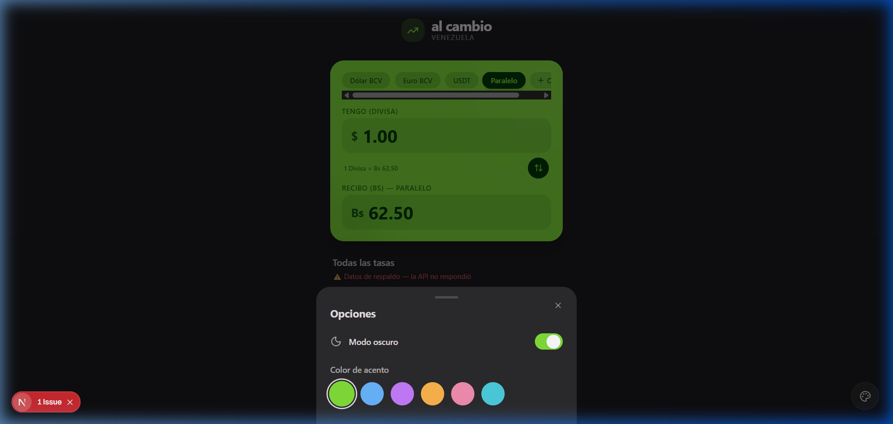

<p align="center">
  
</p>

<h1 align="center">Vex — Tasa libre de Venezuela</h1>

<p align="center">
  Consulta las tasas del dólar, euro y USDT en tiempo real.<br/>
  Rápida, sin anuncios y de código abierto.
</p>

<p align="center">
  
  
  
</p>

---

## ¿Qué es Vex?

**Vex** es una aplicación web gratuita que te permite consultar al instante las principales tasas de cambio en Venezuela:

- 💵 **Dólar BCV** — Tasa oficial del Banco Central de Venezuela
- 💶 **Euro BCV** — Tasa oficial del euro
- 🪙 **USDT** — Tasa del dólar digital (Tether)

Incluye una **calculadora de conversión** integrada: ingresa un monto en dólares, euros o bolívares y obtén el equivalente de forma automática.

## 📸 Capturas de pantalla

<table>
  <tr>
    <td align="center"><strong>Splash Screen</strong></td>
    <td align="center"><strong>Pantalla principal</strong></td>
  </tr>
  <tr>
    <td></td>
    <td></td>
  </tr>
  <tr>
    <td align="center"><strong>Calendario histórico</strong></td>
    <td align="center"><strong>Ajustes</strong></td>
  </tr>
  <tr>
    <td></td>
    <td></td>
  </tr>
</table>

## ✨ Características

| Función | Descripción |
|---|---|
| 📱 **PWA** | Instálala en tu celular como una app nativa |
| ⚡ **Rápida** | Las tasas se cachean en el servidor; la app carga en menos de 1 segundo |
| 🔄 **Actualización automática** | Se consulta la API cada 8 horas, sin necesidad de hacer nada |
| 🧮 **Calculadora** | Convierte entre USD/EUR ↔ Bolívares al instante |
| 📋 **Copiar montos** | Un toque para copiar cualquier cantidad al portapapeles |
| 📅 **Historial** | Calendario con las tasas de días anteriores |
| 🎨 **Personalizable** | Modo oscuro/claro y colores de acento |
| 📴 **Funciona sin internet** | La PWA muestra la última información disponible offline |
| 🚫 **Sin anuncios** | Experiencia limpia, sin banners ni pop-ups |

## 🚀 Instalación local

```bash
# Clonar el repositorio
git clone https://github.com/solamentepuerta/open-cambio.git
cd open-cambio

# Instalar dependencias
npm install

# Ejecutar en modo desarrollo
npm run dev
```

Abre [http://localhost:3000](http://localhost:3000) en tu navegador.

### Variables de entorno

Crea `.env.local` con las credenciales del entorno. Los secretos deben tener al menos 32 caracteres:

```env
UPSTASH_REDIS_REST_URL=
UPSTASH_REDIS_REST_TOKEN=
API_SECRET=
CRON_SECRET=
BCV_SCRAPER_URL=https://puertale.com/bcv-scraper-test/latest.json
BCV_HISTORY_URL=https://puertale.com/bcv-scraper-test/daily-rates.json
```

`CRON_SECRET` protege el refresco diario configurado en `vercel.json` para las 21:00 de Venezuela (01:00 UTC). Rota `API_SECRET` y `CRON_SECRET` periódicamente en Vercel y en cualquier integración que los utilice.

`BCV_SCRAPER_URL` apunta al JSON generado cada cuatro horas por el recolector PHP. El JSON combina USD/EUR del BCV con USDT/VES de USDT.com.ve. Los snapshots con más de 24 horas se descartan para no publicar tasas viejas; si una fuente no está disponible, la aplicación continúa usando DolarAPI y Pydolarve como respaldo.

`BCV_HISTORY_URL` contiene hasta 400 días de tasas guardadas de forma atómica en cPanel. La aplicación combina ese historial principal con Redis y los datos locales, que permanecen como respaldo. Las fechas importadas desde el histórico del BCV pueden no incluir `usdt`; la aplicación las acepta y muestra solo USD/EUR para esas fechas.

## 🏗️ Tecnologías

- **[Next.js 16](https://nextjs.org/)** — Framework de React con App Router
- **[Tailwind CSS](https://tailwindcss.com/)** — Estilos utilitarios
- **[Zustand](https://zustand-demo.pmnd.rs/)** — Estado global ligero
- **[Lucide React](https://lucide.dev/)** — Iconos SVG
- **[Cal Sans](https://github.com/calcom/font)** — Tipografía display

## 📡 Fuentes de datos

Las tasas se obtienen de APIs públicas con un sistema de respaldo en cascada:

1. **Principal** → [dolarapi.com](https://ve.dolarapi.com) (BCV, Euro, USDT)
2. **Respaldo** → [pydolarve.org](https://pydolarve.org)
3. **Último recurso** → Datos locales almacenados en caché

## 🧰 Scraper BCV en PHP (para terceros)

El recolector que alimenta las tasas vive en [`docs/scraper-bcv.php`](docs/scraper-bcv.php) y su documentación pública está en [opencambio.puertale.com/docs/scraper](https://opencambio.puertale.com/docs/scraper).

Puedes descargar el paquete completo (scraper, `.htaccess`, README y certificados) desde [opencambio.puertale.com/downloads/scraper-bcv.zip](https://opencambio.puertale.com/downloads/scraper-bcv.zip). La documentación incluye ejemplos para consumir los JSON desde **JavaScript, Python, PHP, Java y C#**.

Los archivos fuente descargables viven en `docs/` y el ZIP en `public/downloads/scraper-bcv.zip`. Si actualizas el scraper o el README, regenera el ZIP para que el paquete siga sincronizado.

Consulta el BCV y USDT.com.ve, y publica:

- `latest.json` — última captura con USD, EUR y USDT.
- `daily-rates.json` — historial diario de hasta 400 días.

El cron recomendado es cada cuatro horas:

```cron
17 */4 * * * /usr/local/bin/php /ruta/scraper.php >> /ruta/scraper.log 2>&1
```

Si curl falla con `unable to get local issuer certificate`, agrega el intermedio **Sectigo Public Server Authentication CA OV R36** a `certs/cacert.pem`. No desactives la verificación TLS del scraper.

## 🙌 Agradecimientos

Gracias a quienes reportaron el fallo del recolector y aportaron mejoras para que las tasas y el historial volvieran a actualizarse. El scraper queda documentado y disponible para que otros proyectos lo reutilicen.

## 🤝 Contribuir

Las contribuciones son bienvenidas. Si quieres mejorar Vex:

1. Haz un fork del repositorio
2. Crea una rama con tu cambio (`git checkout -b mi-mejora`)
3. Haz commit de tus cambios (`git commit -m "Añadir mi mejora"`)
4. Haz push a la rama (`git push origin mi-mejora`)
5. Abre un Pull Request

Consulta también el [roadmap del proyecto](ROADMAP.md) para ver las mejoras previstas.

## 📄 Licencia

Este proyecto es de **código abierto** y está disponible bajo la licencia [MIT](LICENSE).

---

<p align="center">
  Hecho con 💚 para Venezuela
</p>
